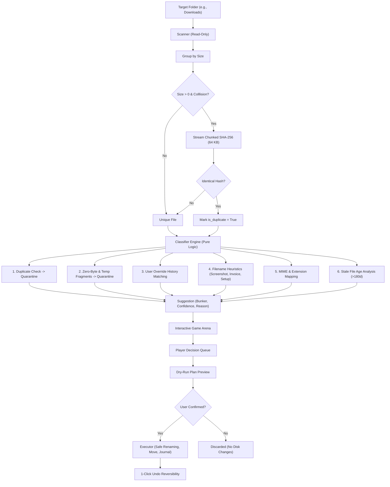

# Taskocalypse ☣️

> **A fast-paced browser game where playing it executes a REAL digital chore in the background.**

[](https://www.python.org/)
[](https://fastapi.tiangolo.com/)
[](LICENSE)
[]()

---

## 1. Chosen Vertical
**"Messy Folder Apocalypse"**: Users point the application at any cluttered folder (such as `Downloads` or `Desktop`). Files arrive in the game arena as incoming apocalypse survivors or digital zombies. Every decision the player makes (swiping, tapping, or hitting hotkeys `1`-`8` to route a file to a protective bunker) prepares a confirmed disk reorganization plan that moves, archives, or quarantines files safely.

---

## 2. Problem and Approach
Digital chores—especially tidying up hundreds of miscellaneous downloads, duplicate invoices, installation packages, and forgotten screenshots—are notoriously prone to procrastination.

**Taskocalypse** inverts the chore into a thrilling arcade defense experience:
- **Immediate Gamification:** Rapid card/lane gameplay with countdown timers, combo multipliers, sound effects, and score progression.
- **Context-Aware Classification Engine:** Pure heuristic AI suggests the ideal bunker for each file based on patterns, age, size, duplicates, and learned user preferences.
- **Zero-Risk Dry-Run Safety:** The game never touches the filesystem during play. Actions build an action plan preview. Only upon explicit player confirmation at the end does the executor safely move files.
- **Always Reversible:** "Trash" routes to an internal quarantine directory (`.taskocalypse_quarantine/`), and 1-click Undo (or hotkey `Z`) instantly restores everything.

---

## 3. How the Logic Works



The classification engine evaluates file metadata in strict priority order:
1. **Duplicates:** Byte-level hash match flags file as duplicate of earlier path -> `Trash-Quarantine` (98% confidence).
2. **Zero-Byte Files:** Empty files with no content -> `Trash-Quarantine` (95% confidence).
3. **Download Fragments:** Incomplete downloads (`.crdownload`, `.part`, `.tmp`) -> `Trash-Quarantine` (96% confidence).
4. **Learned Player Overrides:** Heuristic weights recorded in local history modify future suggestions based on personal habits.
5. **Pattern Heuristics:**
   - Screenshots (`Screenshot`, `Screen Shot`, `snip`) -> `Images`
   - Invoices & Statements (`invoice`, `receipt`, `bill`, `tax`) -> `Documents`
   - Installers (`setup`, `installer`, `patch`) -> `Installers`
   - Copy Suffixes (`(1)`, ` - Copy`) -> Highlights duplicate warnings
6. **Age Thresholds:** Installers older than 180 days suggest `Trash-Quarantine`.
7. **Extension & MIME Mapping:** Standard format routing to Documents, Images, Videos, Code, Archives, or Installers.
8. **Safe Fallback:** Unknown formats route to `Keep in Place` (leaving files untouched).

---

## 4. How to Run and Test

### Prerequisites
- Python 3.11+
- Git (optional)

### Setup & Launch
```bash
# 1. Install dependencies
pip install -r requirements.txt

# 2. (Optional) Generate a messy test folder in seconds
python demo_setup.py

# 3. Start the Taskocalypse server
python -m app
```
Visit **[http://127.0.0.1:8000](http://127.0.0.1:8000)** in your browser.

### Running Tests & Linting
```bash
# Run pytest test suite with coverage report (91%+ coverage)
python -m pytest

# Run ruff linter & style formatter
python -m ruff check app tests demo_setup.py
python -m ruff format --check app tests demo_setup.py
```

### PowerShell or Make Shortcuts
```powershell
# Using PowerShell convenience script
.\run.ps1 test
.\run.ps1 lint
.\run.ps1 demo
.\run.ps1 run

# Or using Make
make test
make lint
make run
```

---

## 5. Features

- **Fast-Paced Lane Gameplay:** Files stream in with real-time countdown progress bars.
- **Calm Mode:** Toggle with `C` or select from the dropdown for a relaxed, zero-timer sorting experience.
- **Context-Aware Suggestions:** Plain-language rationale displayed for every file (e.g., *"Identical duplicate of report.pdf (exact byte hash)"*).
- **Combo Multipliers:** Chaining matching suggestions builds combo streaks (`x1`, `x2`, `x3` ... `RAMPAGE!`).
- **Sound Effects:** Pure Web Audio API synthesized tones (chimes, laser combos, quarantine blasts, victory fanfares) with zero external audio assets.
- **Dry-Run Inspection:** Comprehensive summary breakdown (Files sorted, Quarantined count, MB organized, score) and itemized change preview.
- **Instant 1-Click Undo:** Reverts executed moves via atomic journal records.

---

## 6. Security & Threat Model

### Threat Model
| Threat | Risk Level | Mitigation in Taskocalypse |
| :--- | :--- | :--- |
| **Path Traversal / Escape** | Critical | Paths are strictly resolved against `root_path`. Any relative path escaping root (via `..`, `/etc`, or symlink redirection) raises `SecurityViolationError`. |
| **Accidental Data Loss** | Critical | **Permanent deletion is blocked.** Quarantined files are moved to `.taskocalypse_quarantine/`. On filename collisions, files are safely renamed with `(1)`, `(2)`. Never overwrites. |
| **Unintended Disk Mutation** | High | Pure dry-run by default. The executor requires an explicit `confirmed=True` flag and a valid anti-forgery token. |
| **Cross-Site Request Forgery (CSRF)** | High | Per-session cryptographic CSRF tokens issued on handshake and validated on all mutating endpoints (`/api/plan`, `/api/execute`, `/api/undo`, `/api/override`). |
| **Network Exposure** | Medium | Server explicitly binds to `127.0.0.1` only. Strict CORS limits origins to localhost. |
| **DOM XSS Injection** | Medium | All filenames, paths, and rationale strings are rendered in the DOM strictly via `textContent` and safe text nodes. No `innerHTML` with untrusted data. |
| **Denial of Service / Flooding** | Medium | Sliding-window rate limiting on mutation endpoints (`/api/execute`, `/api/undo`). Max scan file caps (`MAX_FILES_PER_SCAN = 500`). |
| **Security Headers** | Low | Injected on every response: Content-Security-Policy (CSP), `X-Content-Type-Options: nosniff`, `X-Frame-Options: DENY`, `Referrer-Policy`. |

---

## 7. Accessibility Measures (WCAG AA)

- **Full Keyboard Playability:** Hotkeys `1`-`8` for bunkers, `Space` / `Enter` for instant suggestion acceptance, `C` for Calm Mode, `M` for Sound, `Z` for Undo, `?` for Help.
- **Visible Focus Indicators:** Prominent `:focus-visible` styling with high-contrast focus rings.
- **Screen Reader Support:** Semantic HTML5 elements (`<header>`, `<main>`, `<nav>`, `<dialog>`, `<button>`) and dedicated `aria-live="polite"` live announcements for incoming files, suggestions, and score changes.
- **Non-Color-Dependent UI:** Every bunker features distinct iconography, numeric key indicators, and clear text labels.
- **Colorblind-Safe Palette:** High-contrast color values exceeding WCAG AA contrast ratios.
- **Motion Preferences:** Full `@media (prefers-reduced-motion: reduce)` support disables non-essential animations.
- **Scalable Typography:** Built with relative `rem` units for seamless browser zooming.
- **Skip Navigation Link:** Allows quick keyboard navigation past headers directly to the game arena.

---

## 8. Efficiency Decisions

- **Lazy File Scanning:** Uses `os.scandir` without redundant stat calls (`follow_symlinks=False`).
- **Two-Phase Duplicate Detection:** Groups files by exact `st_size` first. Only non-zero candidates sharing a collision size are hashed.
- **Chunked File Streaming:** Hashes files in 64 KB chunks (`HASH_CHUNK_SIZE`) to ensure large files never spike memory.
- **Hash Caching:** Hashes are cached by `(path, mtime, size)` to eliminate re-computation across multiple passes.
- **Frontend Performance:** Animation timers leverage `requestAnimationFrame` to eliminate layout thrashing. Zero external CDNs or heavy frameworks; entire repo is lightweight (<1 MB).

---

## 9. Assumptions and Limitations

- **Local Execution:** Designed as a desktop-local companion tool bound to localhost (`127.0.0.1`).
- **File System Permissions:** The executing user must possess read/write permissions in the selected folder.
- **Cloud-Synced Placeholders:** Cloud storage files with offline-only metadata (e.g. OneDrive zero-byte stubs) may be detected as 0 bytes if not hydrated.
- **System Folders:** System directories (e.g. `C:\Windows`, root drive roots) should not be targeted; Taskocalypse is designed for user clutter folders (Downloads, Desktop, Temp staging).

---

## 10. Project Structure

```
Taskocalypse/
├── app/
│   ├── __init__.py           # Package initialization & version
│   ├── __main__.py           # Uvicorn entrypoint (python -m app)
│   ├── api.py                # FastAPI endpoints, CSRF, security middleware
│   ├── classifier.py         # Pure context-aware classification logic (no I/O)
│   ├── config.py             # Bunker definitions, patterns, thresholds
│   ├── executor.py           # The ONLY module allowed to mutate filesystem
│   ├── history.py            # Local override frequency tracker
│   ├── models.py             # Pydantic schema validation models
│   └── scanner.py            # Read-only scanner & duplicate detection
├── static/
│   ├── game.js               # Vanilla arcade game engine & Web Audio synthesizer
│   ├── index.html            # Accessible SPA interface
│   └── style.css             # High-contrast, responsive stylesheet
├── tests/
│   ├── __init__.py
│   ├── test_api.py           # End-to-end API integration tests
│   ├── test_classifier.py    # Unit tests for pure classification heuristics
│   ├── test_coverage_boost.py# Branch coverage tests
│   ├── test_executor.py      # Mutation, dry-run, and undo unit tests
│   ├── test_scanner.py       # Read-only scanner and duplicate tests
│   └── test_security.py      # Traversal, CSRF, and rate-limit security tests
├── demo_setup.py             # Quick generator for fake messy demo folder
├── Makefile                  # Cross-platform make commands
├── run.ps1                   # Windows PowerShell convenience runner
├── pyproject.toml            # Ruff and Pytest configuration
├── requirements.txt          # Pinned production & testing dependencies
├── .gitignore                # Git ignore rules
└── LICENSE                   # MIT License
```

