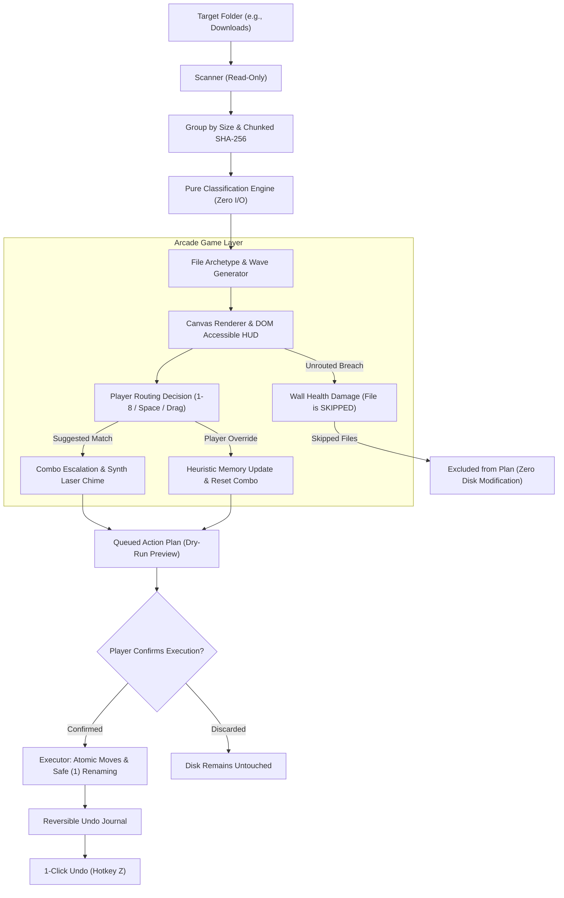

# Taskocalypse: Bunker Defense ☣️

> **A fast-paced browser arcade game where playing it executes a REAL digital chore in the background.**

[](https://www.python.org/)
[](https://fastapi.tiangolo.com/)
[](LICENSE)
[]()

---

## 1. Chosen Vertical: "Messy Folder Apocalypse"
Digital chores—especially tidying up hundreds of miscellaneous downloads, duplicate invoices, installation packages, and forgotten screenshots—are notoriously prone to procrastination.

**Taskocalypse: Bunker Defense** turns this chore into a real-time defense game:
A digital city is under attack by corrupted files marching toward the city wall. The player routes incoming files to protective defense bunkers (`1`-`8`) before they arrive. Every routing decision secretly compiles an atomic, reversible file-sorting action plan. Nothing touches the disk during play; only upon explicit confirmation at the dry-run review does the engine safely organize files.

---

## 2. Real-World Mapping: Enemy ➔ File Property ➔ Bunker ➔ Disk Action

| Enemy Archetype | File Property / Heuristic | Assigned Bunker | Real Disk Action on Confirmation |
| :--- | :--- | :--- | :--- |
| **📄 Document Survivor** | `.pdf`, `.docx`, `.xlsx`, `.txt`, invoices, receipts | **Documents** (`1`) | Moves to `root/Documents/` (collision-safe rename) |
| **🖼️ Image Survivor** | `.jpg`, `.png`, `.webp`, `.svg`, screenshots | **Images** (`2`) | Moves to `root/Images/` (collision-safe rename) |
| **🎬 Video Marauder** | `.mp4`, `.mov`, `.mkv`, media clips | **Videos** (`3`) | Moves to `root/Videos/` (collision-safe rename) |
| **💻 Code Runner** | `.py`, `.js`, `.ts`, `.json`, `.yaml`, scripts | **Code** (`4`) | Moves to `root/Code/` (collision-safe rename) |
| **📦 Archive Golem** | `.zip`, `.tar.gz`, `.7z`, packages | **Archives** (`5`) | Moves to `root/Archives/` (collision-safe rename) |
| **⚙️ Installer Brute** | `.exe`, `.msi`, `.dmg`, `.pkg` setup packages | **Installers** (`6`) | Moves to `root/Installers/` (collision-safe rename) |
| **☣️ Temp Zombie** | `.tmp`, `.crdownload`, `.part`, temp logs | **Quarantine** (`7`)| Reversibly quarantined in `.taskocalypse_quarantine/` |
| **👾 Glitch Monster** | Duplicate file (exact byte hash match) | **Quarantine** (`7`)| Reversibly quarantined in `.taskocalypse_quarantine/` |
| **👻 Ghost** | Zero-byte empty file or ancient untouched log | **Quarantine** (`7`)| Reversibly quarantined in `.taskocalypse_quarantine/` |
| **🐉 Duplicate Hydra** | Boss cluster of N identical files | **Quarantine** (`7`)| All N duplicates purged to `.taskocalypse_quarantine/` |
| **🛡️ Unrecognized / Kept**| Unknown extension or player override to Keep | **Keep** (`8`) | **No disk move**; file remains in current location |
| **💥 Wall Breach (Skipped)**| File reaches city wall without player routing | **Skipped** | **NO ACTION TAKEN**; skipped files are completely untouched |

---

## 3. How the Architecture & Workflow Operates



---

## 4. Controls & Input Mapping

| Key / Gesture | Action | Description |
| :--- | :--- | :--- |
| <kbd>1</kbd> – <kbd>8</kbd> | Route to Bunker | Routes targeted file to Documents, Images, Videos, Code, Archives, Installers, Quarantine, or Keep |
| <kbd>Space</kbd> / <kbd>Enter</kbd> | Accept AI Suggestion | Automatically routes to the AI-recommended bunker for rapid arcade flow |
| <kbd>Tab</kbd> / <kbd>Shift+Tab</kbd> | Cycle Target Enemy | Cycles selection forward or backward through incoming enemies |
| <kbd>Click</kbd> / <kbd>Tap</kbd> | Direct Target Select | Click on any enemy canvas sprite or tap on mobile to target |
| <kbd>Drag & Drop</kbd> | Drag to Bunker | Drag an enemy sprite and drop onto any bunker dock button |
| <kbd>P</kbd> / <kbd>Escape</kbd> | Pause Game | Toggles game pause and opens the accessible Pause Menu |
| <kbd>C</kbd> | Toggle Calm Mode | Switches to zero-timer, zero-damage calm sorting mode |
| <kbd>M</kbd> | Toggle Sound | Toggles Web Audio procedural sound effects (starts muted until enabled) |
| <kbd>Z</kbd> | Undo Last Run | Restores all files to their exact original locations after execution |
| <kbd>?</kbd> | Help & Safety Guide | Opens modal dialog with game objectives, controls, and safety guarantees |

---

## 5. Game Modes & Power-Ups

### Modes
- **Campaign Mode:** Waves of files with procedural day/night shifts (Dawn ➔ Day ➔ Dusk ➔ Night), boss waves (Duplicate Hydra), increasing speed, and wave clear bonuses.
- **Endless Mode:** Continuous survival defense with relentless speed scaling.
- **Calm Mode:** Zero timers, zero damage. Files advance to waiting positions and wait patiently for player decisions.

### Power-Ups
- **⚡ Slow-Mo EMP (150 pts):** Slows all active files by 75% for 6 seconds.
- **🤖 Auto-Turret (300 pts):** Instantly auto-routes 3 enemies with confidence $\ge 90\%$ to their suggested bunkers.
- **🛡️ City Shield (200 pts):** Absorbs an unrouted file breach, completely preventing city wall health loss.
- **💥 Cluster Purge (250 pts):** Instantly neutralizes Duplicate Hydra boss clusters, sending all copies to Quarantine.

---

## 6. Security Measures & Threat Model

| Threat Scenario | Risk Level | Mitigation & Implementation |
| :--- | :---: | :--- |
| **Path Traversal / Sandbox Escape** | Critical | Every relative path is validated via `verify_contained_path()`. Rejects `..`, drive letters, and symlink escapes with `SecurityViolationError`. |
| **Accidental Data Loss** | Critical | **Permanent deletion is prohibited.** Files marked for "Trash" are moved to `.taskocalypse_quarantine/`. On collisions, safe counters `(1)` are appended. |
| **Unintended Disk Modification** | High | Pure dry-run by default. The executor requires an explicit `confirmed=True` flag and valid session CSRF token. |
| **DOM XSS Injection** | Medium | Filenames, paths, and reasons are rendered strictly via `textContent` or canvas `fillText`. **Zero innerHTML with file data.** Verified by automated security test suite. |
| **Content Security Policy (CSP)** | High | Response headers enforce `default-src 'self'`. Zero inline scripts, zero inline styles, zero `eval()` / `new Function()`. |
| **CSRF / Cross-Site Attacks** | High | Cryptographically secure tokens (`secrets.token_urlsafe(32)`) required on mutating endpoints (`/api/plan`, `/api/execute`, `/api/undo`, `/api/override`). |
| **Network Exposure & Rate Limiting**| Medium | Localhost binding (`127.0.0.1`), strict CORS, and sliding-window rate limiting on mutating endpoints. |

---

## 7. Accessibility (WCAG AA Compliance)

- **Semantic DOM Mirroring:** All canvas action is mirrored in real, semantic DOM elements: real focusable bunker buttons with `aria-label`, a live targeted file card (`#hud-target-card`), and an accessible health bar (`role="progressbar"`).
- **Throttled Screen Reader Announcements:** Dedicated `aria-live="polite"` announcer throttled to prevent spamming assistive technology while announcing targets, suggestions, routing results, and health warnings.
- **Full Keyboard Navigation:** 100% playable via keyboard alone with visible focus rings (`:focus-visible`).
- **Non-Color Reliance:** Every enemy and bunker features unique shapes, distinct icons, and clear text labels (never color alone).
- **Motion & Contrast Preferences:** Full support for `prefers-reduced-motion: reduce` (disables screen shake, flashes, and smooth transitions) and high-contrast color palette exceeding WCAG AA standards.
- **Assist Mode & Touch:** 44px+ hit targets for mobile touches, and Assist Mode auto-pauses when new files arrive to accommodate motor-impaired players.

---

## 8. Efficiency Decisions

- **Lazy File Scanning:** Uses `os.scandir` without redundant stat calls (`follow_symlinks=False`).
- **Two-Phase Duplicate Detection:** Groups files by exact `st_size` first. Only non-zero candidates sharing a collision size are hashed.
- **Chunked File Streaming:** Streaming SHA-256 in 64 KB chunks (`HASH_CHUNK_SIZE`) guarantees large files never exhaust memory.
- **In-Memory Hash Caching:** Hashes cached by `(path, mtime, size)`.
- **Canvas Rendering Optimization:** Fixed-timestep loop (60 FPS base with delta clamping), DPR capped at 2.0, pre-allocated particle object pool (zero allocation in the hot loop), and no per-frame DOM layout thrashing.
- **Featherweight Size:** Entire repository is under **0.4 MB** (no external video, audio, or node_modules binaries).

---

## 9. How to Run and Test

### Setup
```bash
# 1. Install pinned dependencies
pip install -r requirements.txt

# 2. Generate a messy demo folder with all 10 enemy archetypes
python demo_setup.py

# 3. Start Taskocalypse local server
python -m app
```
Visit **[http://127.0.0.1:8000](http://127.0.0.1:8000)** in your browser.

### Running Test Suites
```bash
# Run Python backend, security, and integration tests (39 tests, 89%+ coverage)
python -m pytest

# Run JS pure engine tests (Spawner, Waves, Scoring, PlanBuilder via Node.js test runner)
node --test tests/js/*.test.js

# Run Ruff linter and formatting checks
python -m ruff check app tests api demo_setup.py
python -m ruff format --check app tests api demo_setup.py
```

### PowerShell or Make Shortcuts
```powershell
# Windows PowerShell
.\run.ps1 test
.\run.ps1 lint
.\run.ps1 demo
.\run.ps1 run

# Linux / macOS
make test
make lint
make demo
make run
```

---

## 10. Project Structure

```
Taskocalypse/
├── app/
│   ├── __init__.py           # Package exports & version
│   ├── __main__.py           # Server runner (python -m app)
│   ├── api.py                # FastAPI endpoints, CSRF, security middleware
│   ├── classifier.py         # Pure heuristic engine (zero I/O)
│   ├── config.py             # Bunker definitions, regex patterns, constants
│   ├── executor.py           # Sole filesystem mutation module
│   ├── history.py            # Local override frequency memory
│   ├── models.py             # Pydantic validation schemas
│   └── scanner.py            # Read-only scanner & duplicate detection
├── static/
│   ├── index.html            # Semantic accessible SPA + Canvas arena
│   ├── style.css             # High-contrast theme, responsive layout
│   └── js/
│       ├── main.js           # Module entrypoint & loop coordinator
│       ├── api/
│       │   └── client.js     # CSRF-backed API fetch client
│       ├── audio/
│       │   └── synth.js      # Web Audio procedural sound synthesizer
│       ├── engine/
│       │   ├── constants.js  # Enemy archetypes, bunkers, speeds, powerups
│       │   ├── state.js      # Central game state container
│       │   ├── spawner.js    # File-to-enemy mapping & PRNG spawner
│       │   ├── waves.js      # Wave progression & day/night cycles
│       │   ├── scoring.js    # Combo scaling, score, and summary stats
│       │   ├── powerups.js   # EMP, Auto-Turret, Shield, Purge logic
│       │   └── planBuilder.js# Compiles decisions (skipped files produce no action)
│       ├── input/
│       │   ├── keyboard.js   # Full keyboard navigation (1-8, Space, Tab, P, Z, M, C)
│       │   └── pointer.js    # Mouse/touch selection & drag-and-drop
│       ├── render/
│       │   ├── canvas.js     # Fixed timestep loop & DPR scaling
│       │   ├── background.js # Procedural parallax skyline & day/night shifts
│       │   ├── sprites.js    # Procedural canvas drawing for 10 enemy types & bunkers
│       │   └── particles.js  # Object-pooled particle effects & floating text
│       └── ui/
│           ├── hud.js        # DOM HUD updater (zero layout thrash)
│           ├── announcer.js  # Throttled aria-live announcements
│           ├── dialogs.js    # Pause, settings, and help dialogs
│           └── planReview.js # Dry-run review table & undo UI
├── tests/
│   ├── __init__.py
│   ├── test_api.py           # FastAPI integration tests
│   ├── test_classifier.py    # Unit tests for pure heuristics
│   ├── test_coverage_boost.py# Branch coverage tests
│   ├── test_executor.py      # Mutation, dry-run, and undo tests
│   ├── test_frontend_security_audit.py # Strict static security scanner
│   ├── test_scanner.py       # Scanner & duplicate detection tests
│   ├── test_security.py      # Path traversal, CSRF, rate limit tests
│   └── js/
│       ├── test_engine.test.js       # Pure engine, wave, spawner, scoring tests
│       └── test_plan_builder.test.js # PlanBuilder & safety tests
├── demo_setup.py             # Fake clutter generator (all 10 enemy archetypes)
├── Makefile                  # Cross-platform make commands
├── run.ps1                   # Windows PowerShell convenience script
├── pyproject.toml            # Ruff and Pytest configuration
├── requirements.txt          # Pinned dependencies
├── vercel.json               # Vercel Serverless configuration
├── .gitignore                # Git ignore rules
└── LICENSE                   # MIT License
```
